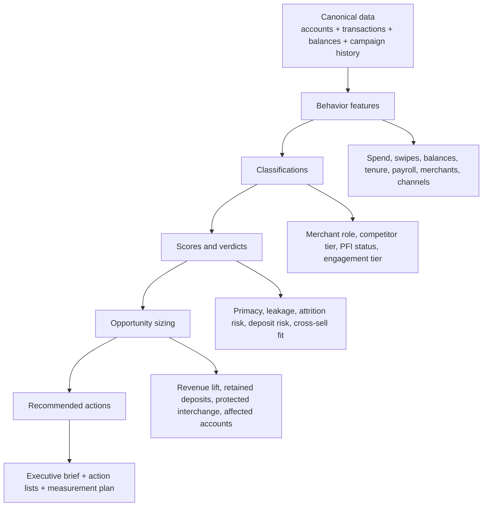

# Transactional Intelligence Analysis Strategy

Visual review map: [`transactional-intelligence-analysis-map.html`](transactional-intelligence-analysis-map.html)

Browser HTML strategy view: [`transactional-intelligence-strategy.html`](transactional-intelligence-strategy.html)

Data science review and analysis plan: [`DATA_SCIENCE_ANALYSIS_PLAN.md`](DATA_SCIENCE_ANALYSIS_PLAN.md)

This defines the analytical product: what the Transactional Intelligence Engine actually knows, scores, recommends, and sells.

The engine should not be positioned as a reporting pipeline. It should be positioned as a behavioral intelligence system for financial institutions:

> Raw account and transaction files -> normalized financial behavior -> relationship verdicts -> quantified opportunities -> targeted actions.

The approved V1 framing is that the Transactional Intelligence Engine is not the 20+ analyses themselves. Those analyses are the source intellectual property. The engine is the system that turns transaction evidence into a financial-life understanding, then into relationship diagnosis, opportunity, action, and measured outcomes.

```text
TRANSACTIONAL INTELLIGENCE ENGINE V1

Raw observations
  -> Behavioral signals
  -> Financial-life understanding
  -> Relationship intelligence
  -> Opportunity intelligence
  -> Recommended strategy
  -> Targeted action
  -> Measured outcome
```

This hierarchy should become the organizing model for the product. Every analysis section should be evaluated by where it contributes: does it create a signal, strengthen the financial-life picture, diagnose relationship position, size an opportunity, recommend an action, or measure whether the action worked?

## The Core Analytical Promise

The engine answers five executive questions every month:

1. **Who are our active relationships?**
   Which accounts and members are open, eligible, active, engaged, dormant, new, seasoned, personal, business, branch-associated, debit-enabled, payroll-linked, and balance-bearing?

2. **Where is money moving?**
   Which merchants, MCCs, channels, transaction types, competitors, financial-service categories, and payment ecosystems are capturing activity?

3. **Who owns the relationship?**
   Is this institution primary, split, or secondary for each account/member? Where are payroll, deposits, spend, balances, and recurring activity pointing?

4. **Where is value leaking or at risk?**
   Which behaviors signal revenue leakage, deposit flight, attrition, under-engagement, competitor capture, direct-deposit gaps, interchange gaps, or Reg E/overdraft opportunity?

5. **What should we do next?**
   Which target populations should marketing, retail, branch, lending, deposit, and executive teams act on, with what message, offer, channel, and measurement plan?

## The Four Disciplines Inside The Engine

| Discipline | What it contributes | Product output |
|---|---|---|
| Data science | Feature engineering, classification, scoring, cohort analysis, causal/lift measurement, prediction | Scores, segments, forecasts, opportunity estimates, confidence |
| Consulting | Executive framing, issue trees, prioritization, opportunity sizing, SCQA storyline, recommendations | Board-ready insights, action roadmap, executive brief |
| Data strategy | Data contracts, canonical tables, lineage, quality rules, coverage, confidence, repeatable marts | Trusted data foundation and explainability |
| Marketing strategy | Audience selection, trigger logic, message/offer strategy, test design, response measurement | Target lists, campaign plays, lift reporting |

The product becomes credible when all four are present. Data science without consulting is a notebook. Consulting without data lineage is a slide deck. Marketing without measurement is campaign guessing. Data strategy without recommendations is plumbing.

## Intelligence Domains

The current repo's 20+ sections should roll up into a smaller set of sellable intelligence domains.

| Domain | Core question | Current sections |
|---|---|---|
| Portfolio Foundation | What is the usable customer/account base? | Overview, general, product, business_accts, personal_accts |
| Spend and Merchant Intelligence | Where does transaction activity concentrate and change? | merchant, mcc_code, transaction_type, branch_txn |
| Relationship and Primacy | Are we the primary institution, and where is the relationship thin? | payroll, relationship, balance, engagement, segment_evolution |
| Competitive Leakage | Which external institutions and ecosystems are capturing wallet share? | competition, financial_services |
| Revenue and Value | What revenue is created, missing, or at risk? | interchange, value, rege, rege_overdraft |
| Lifecycle and Retention | Who is growing, degrading, dormant, or likely to leave? | attrition, attrition_txn, retention, ICS_cohort, ics_acquisition |
| Campaign Effectiveness | Which outreach moved behavior and which cohorts should be targeted next? | mailer, campaign |
| Executive Synthesis | What are the top decisions and actions? | insights, executive |

## Analysis Flow



The engine should make this path explicit. Every recommendation should trace back to the data features and sections that produced it.

## The Insight Object

Every analysis section should eventually emit standardized insight records, not just charts.

```yaml
insight_id: payroll_leakage_001
domain: Relationship and Primacy
section_id: txn.payroll
population: active checking households
finding: Households receiving payroll elsewhere are 2.6x more likely to bank elsewhere.
metric_name: external_payroll_share
current_value: 0.34
comparison_value: 0.18
delta: 0.16
affected_accounts: 1842
opportunity_amount: 8420000
confidence: high
confidence_reasons:
  - payroll pattern observed in 6 consecutive months
  - account match coverage above 95%
recommended_action: Target external-payroll households with primary banking conversion offer.
target_list_ref: action_list.payroll_conversion_aug2026
source_tables:
  - core.accounts
  - core.transactions
  - mart.account_monthly
source_sections:
  - txn.payroll
  - txn.relationship
```

This is the unit the product sells. A slide, dashboard tile, action list, or API response should all be renderings of the same insight object.

## Opportunity Scoring

Use one common scoring method across domains so executive recommendations are comparable.

```text
Opportunity Score =
  Impact
  x Addressability
  x Confidence
  x Urgency
```

| Factor | Meaning | Examples |
|---|---|---|
| Impact | How large is the upside or risk? | dollars, accounts, deposits, interchange, retention |
| Addressability | Can the institution act on it? | named accounts, known branch, known segment, clear offer |
| Confidence | How trustworthy is the signal? | source coverage, data quality, history length, model stability |
| Urgency | Why now? | worsening trend, upcoming campaign window, recent churn, deposit flight |

Example:

| Opportunity | Impact | Addressability | Confidence | Urgency | Result |
|---|---:|---:|---:|---:|---|
| Payroll conversion | High | High | Medium/High | High | Top priority |
| Merchant concentration | Medium | Medium | High | Low | Monitor / targeted offer |
| Dormant reactivation | Medium | High | Medium | Medium | Campaign candidate |
| Reg E opportunity | Low/Medium | Medium | High | Medium | Segment play |

Do not let the engine rank by dollar value alone. A huge opportunity with low actionability should not outrank a smaller opportunity with a named, reachable audience and a clear marketing play.

## Data Science Workbench

The data science layer should produce reusable features and models, not one-off chart math.

| Capability | What it does |
|---|---|
| Merchant normalization | Converts raw merchant strings into consolidated brands and categories |
| Counterparty role classification | Tags merchants as competitor FI, payment ecosystem, payroll, lender, subscription, merchant, transfer, ATM, fee |
| Feature engineering | Builds account/month behavior: spend, swipes, balance, payroll, activity, relationship depth, leakage |
| Segmentation | Groups accounts by engagement, relationship, lifecycle, channel, branch, product, age, business/personal |
| PFI verdict | Classifies primary, split, competitor-primary, or no-verdict using retention, balance, and engagement |
| Risk scoring | Flags attrition risk, dormancy progression, deposit flight, disengagement, competitor capture |
| Opportunity sizing | Converts gaps and risk into dollars/accounts using transparent assumptions |
| Uplift / DID analysis | Measures campaign lift against control or counterfactual groups |
| Prediction | Scores next-best product, likely activation, payroll conversion, retention risk |

## Consulting Layer

The consulting layer turns analytics into a decision.

Each executive insight should follow this shape:

```text
Situation: What population or behavior are we looking at?
Finding: What changed or underperforms?
Implication: Why does it matter financially or strategically?
Action: What should the institution do next?
Proof: Which data and method support the claim?
```

Example:

```text
Situation: 18,642 active checking accounts have transaction history and account metadata.
Finding: 1,842 show recurring payroll-like credits outside the institution.
Implication: These households are 2.6x more likely to show external FI activity and lower retained balances.
Action: Run a primary-banking conversion campaign with branch follow-up for high-balance households.
Proof: Payroll detection, competitor FI tagging, balance profile, and 12-month transaction trend.
```

This is how the analysis becomes a board-level recommendation instead of a chart.

## Marketing Strategy Layer

Every material insight should have a corresponding action list.

| Play | Target population | Trigger | Suggested action |
|---|---|---|---|
| Payroll conversion | Active checking accounts with payroll detected elsewhere | Recurring external payroll credits | Direct-deposit switch offer, branch outreach, onboarding sequence |
| Debit activation | Eligible accounts without debit usage | No debit swipes or inactive debit behavior | Activation campaign, card reissue, digital wallet prompt |
| Deposit retention | High-balance accounts with external FI movement | Large recurring outflows to competitor or balance decline | Relationship manager follow-up, rate/product conversation |
| Dormant reactivation | Previously active accounts with activity decay | 3-month decline vs 12-month baseline | Reactivation offer, digital engagement message |
| Merchant/category growth | Strong category spend but weak institution product relationship | High spend in travel, grocery, fuel, SMB categories | Rewards/card usage campaign |
| Relationship expansion | Single-product or thin relationship accounts | Low relationship depth, high external activity | Next-best product offer |
| Reg E / overdraft | Eligible personal debit holders not opted in | Debit activity + opt-out/unknown status | Compliant education and opt-in journey |
| Competitor win-back | Accounts with heavy competitor FI transfers | Competitor share above threshold | PFI conversation, deposit/payroll migration offer |

Each list should include:

- Account/customer id.
- Priority score.
- Reason codes.
- Recommended message.
- Recommended channel.
- Estimated value.
- Suppression flags.
- Measurement/control assignment.

## Measurement Design

The engine should not stop at recommendations. It should measure whether the action worked.

Minimum campaign measurement:

| Metric | Definition |
|---|---|
| Reach | Accounts targeted / eligible population |
| Response | Accounts with desired response behavior |
| Activation | New debit use, direct deposit, balance growth, new product, etc. |
| Lift | Target group change minus control/comparison group change |
| Persistence | Whether behavior remains after 30/60/90 days |
| Revenue | Interchange, fee, deposit value, retained balance, or avoided attrition |

The current mailer/campaign sections already point this way. Productize it so every action list has a measurement frame.

## PFI As The Keystone

PFI should become one of the engine's core verdicts, not a side analysis.

PFI verdict:

```text
Primary with us | Split | Competitor-primary | No verdict
```

Inputs:

- Retention / external FI share.
- Balance held with us.
- Engagement and activity.
- Payroll/direct deposit.
- Competitor and ecosystem movement.
- Data coverage/confidence.

Outputs:

- Per-account PFI status.
- PFI confidence and reason codes.
- Primary competitor, where detectable.
- Migration opportunity.
- Target list for primary-banking campaigns.

PFI is powerful because it ties data science, consulting, and marketing together:

- Data science: classify and score.
- Consulting: tell the executive relationship story.
- Marketing: produce the conversion list.
- Data strategy: prove the lineage and confidence.

## What The Product Sells

| Buyer | What they care about | Engine output |
|---|---|---|
| CEO / executive team | Where are we winning or losing relationships? | Executive brief, top opportunities, PFI verdict, risk/opportunity sizing |
| CMO / marketing | Who should we target and with what message? | Campaign audiences, reason codes, offers, measurement plan |
| Retail / branch leadership | Which branches or segments need action? | Branch scorecards, account lists, local opportunity views |
| CFO / strategy | What is the financial value? | Revenue, deposit, interchange, attrition, and opportunity sizing |
| Data / operations | Can we trust the inputs? | File ledger, data quality, lineage, coverage, contract status |

## Product Positioning

Avoid positioning this as:

- A report generator.
- A dashboard.
- A transaction categorizer.
- A Snowflake migration.
- A PowerPoint automation tool.

Position it as:

> A monthly transactional intelligence engine that turns raw banking files into explainable relationship, revenue, risk, and marketing actions.

Short version:

> Know who owns the relationship, where value is leaking, and who to target next.

## Near-Term Build Plan

1. **Create the insight registry.**
   Add a standard object for findings, opportunity size, confidence, recommended action, and source evidence.

2. **Map every current section to an intelligence domain.**
   Use `docs/ANALYSIS_SECTION_SUMMARY.md` as the starting inventory, then add required inputs and outputs.

3. **Define the first canonical features.**
   Start with account-monthly features: activity, spend, swipes, balance, payroll, competitor movement, external financial-services movement, engagement tier.

4. **Make PFI the first flagship verdict.**
   Use the existing PFI proposal as the methodology seed. Produce a per-account status and a portfolio summary.

5. **Build action lists from insights.**
   For each top opportunity, produce a named audience with reason codes and measurement design.

6. **Retain the current deck output, but make it downstream.**
   The deck should become one rendering of the insight registry, not the source of truth.
