# Transactional Intelligence Engine Blueprint

This is the target architecture for turning the current Velocity analysis pipeline into a file-first transactional intelligence engine.

The key constraint is practical: clients may send up to 15 files per month, there is no API feed yet, and layouts vary. Some files match known formats, some drift, and some may need to be replaced by modified extracts such as the current ODD file. Snowflake should become the durable raw-file and canonical-data layer. Python should keep running the analytics while the canonical model and data contracts mature.

## Architecture Stance

Use a **Snowflake-first intake layer with a Python analytics bridge**.

Do not do a full rewrite of the 20+ analysis sections first. The current repo already contains working analytics, deck generation, manifests, diagnostics, file detection, transaction parsing, and a v3 DuckDB transaction-store pattern. The highest-leverage next step is to move monthly file intake and normalized history into Snowflake, then make Python read stable canonical extracts from Snowflake.

## What Goes Into Snowflake First

Snowflake should own:

- Raw file inventory and metadata for every client/month/file.
- Raw landed rows, even when the layout is not understood yet.
- Data contracts for known layouts.
- Validation results and quarantine status.
- Canonical account, transaction, balance, campaign, merchant, branch, and product tables.
- Reusable monthly feature marts used by analytics sections.

Python should keep owning:

- Existing analysis-section logic during the migration.
- Chart generation and deck packaging.
- Section parity tests against current outputs.
- Complex logic that is still moving or client-specific.

## End-to-End Flow

```mermaid
flowchart LR
  A["Client sends monthly files<br/>up to ~15 per client"] --> B["Landing folder / upload"]
  B --> C["Snowflake raw stage"]
  C --> D["File ledger<br/>client, month, source, hash, layout guess"]
  D --> E["Layout classification"]
  E --> F{"Known contract?"}
  F -- yes --> G["Validate + parse to canonical staging"]
  F -- no --> H["Quarantine + mapping workflow"]
  H --> I["Create or update data contract"]
  I --> G
  G --> J["Canonical tables"]
  J --> K["Feature marts"]
  K --> L["Python analytics sections"]
  L --> M["Insight outputs<br/>deck, workbook, action lists, UI"]
```



## Layered Data Model

| Layer | Purpose | Example objects |
|---|---|---|
| Raw file vault | Preserve exactly what arrived, whether or not it parses | `raw.file_batch`, `raw.file_object`, `raw.file_row_variant`, `raw.file_error` |
| Contract registry | Describe source layouts and how columns map to canonical fields | `config.layout_contract`, `config.layout_field_map`, `config.validation_rule` |
| Canonical staging | One cleaned table per source family before business modeling | `stg.accounts`, `stg.transactions`, `stg.balances`, `stg.campaign_events`, `stg.deferred_revenue` |
| Curated model | Stable business entities used by analytics | `core.accounts`, `core.customers`, `core.transactions`, `core.merchants`, `core.products`, `core.branches` |
| Feature marts | Reusable section-ready datasets | `mart.account_monthly`, `mart.merchant_monthly`, `mart.relationship_snapshot`, `mart.campaign_cohort`, `mart.attrition_features` |
| Output registry | Store what each run produced and why | `out.run`, `out.section_result`, `out.insight`, `out.action_list`, `out.artifact` |

## Raw File Ledger

Every received file should get one ledger row before parsing.

Recommended fields:

| Field | Purpose |
|---|---|
| `file_id` | Stable internal id for the exact delivered file |
| `client_id` | Client/institution id |
| `period` | Reporting period, e.g. `2026.08` |
| `source_family` | `odd`, `transaction`, `balance`, `campaign`, `deferred_revenue`, `workbook`, `unknown` |
| `original_filename` | Delivered name |
| `storage_uri` | Snowflake stage path or cloud object path |
| `content_hash` | Detect redeliveries and changed files |
| `byte_size` | Basic integrity metadata |
| `row_count_raw` | Rows detected before mapping |
| `delimiter_guess` | CSV/TXT delimiter candidate |
| `header_row_guess` | Header position candidate |
| `layout_contract_id` | Matched contract, if any |
| `load_status` | `landed`, `validated`, `canonicalized`, `quarantined`, `failed` |
| `received_at` | Timestamp when file was registered |

This ledger is the product backbone. It lets the engine answer: what did we receive, what changed, what parsed, what failed, which layout did it match, and which analytics were safe to run?

## Data Contracts

A contract is the reusable specification for one file layout from one provider or client family.

Example shape:

```yaml
contract_id: txn.velocity_standard.v1
source_family: transaction
match:
  filename_patterns:
    - "*transaction*"
    - "*monthlydebittransactions*"
  delimiters: ["tab", "comma", "pipe", "semicolon"]
  min_columns: 10
  header_detection: sniff
canonical_fields:
  transaction_date:
    required: true
    type: date
    aliases: ["transaction_date", "Transaction Date", "TXN_DT", "trans date"]
  account_id:
    required: true
    type: string
    aliases: ["primary_account_num", "ACCOUNT_NBR", "acct"]
  amount:
    required: true
    type: decimal
    aliases: ["amount", "AMOUNT", "txn amount"]
  merchant_name:
    required: false
    type: string
    aliases: ["merchant_name", "MERCHANT", "description"]
  transaction_type:
    required: false
    type: string
    aliases: ["transaction_type", "TRAN_TYPE", "channel"]
validation:
  - transaction_date not null
  - amount parse success rate >= 99.5%
  - account_id match rate to account file >= 95%
  - period coverage overlaps requested reporting month
```

Contracts should live in version control first, then be mirrored into Snowflake. This keeps contract changes reviewable and testable.

## Handling Files That Do Not Match

Do not block the whole client run just because one file is unfamiliar.

Use this routing:

| Situation | Engine behavior |
|---|---|
| Known layout, valid file | Load to canonical staging and mark ready |
| Known layout, minor drift | Load mapped fields, flag warnings, preserve unmapped columns |
| Known layout, critical failure | Quarantine file and mark affected sections unavailable |
| Unknown layout | Land raw, infer structure, create mapping task, do not run dependent sections |
| Missing raw file but modified extract exists | Use the modified extract as a substitute source and stamp lineage |
| Missing raw and no substitute | Skip dependent sections with clear reason in run manifest |

The current ODD flow is the model for a modified extract fallback: if a raw source is not workable yet, define a contract for the extract and keep the lineage explicit.

## Canonical Tables

Start small. The first version does not need every possible banking table.

### `core.accounts`

- `client_id`
- `account_id`
- `customer_id`
- `product_code`
- `product_name`
- `stat_code`
- `business_flag`
- `branch_id`
- `date_opened`
- `date_closed`
- `avg_balance`
- `has_debit`
- `reg_e_status`
- `source_file_id`

### `core.transactions`

- `client_id`
- `transaction_id`
- `account_id`
- `transaction_date`
- `amount_signed`
- `amount_abs`
- `direction`
- `transaction_type`
- `channel`
- `mcc_code`
- `merchant_raw`
- `merchant_consolidated`
- `merchant_id`
- `card_present`
- `institution`
- `transaction_code`
- `source_file_id`

Keep both `amount_signed` and `amount_abs`. The repo audits already show why losing sign semantics can distort payroll and debit/credit logic.

### `mart.account_monthly`

- `client_id`
- `period`
- `account_id`
- `spend`
- `swipes`
- `active_flag`
- `merchant_count`
- `payroll_detected`
- `external_financial_services_flag`
- `engagement_tier`
- `balance_band`
- `relationship_depth`

### `mart.merchant_monthly`

- `client_id`
- `period`
- `merchant_consolidated`
- `mcc_code`
- `account_count`
- `transaction_count`
- `spend`
- `avg_ticket`
- `new_merchant_flag`
- `competitor_category`

## Mapping Current Analysis Sections

The repo sections should become consumers of canonical tables and feature marts.

| Section group | Primary future inputs |
|---|---|
| Portfolio Overview | `core.accounts`, `core.transactions`, `mart.account_monthly` |
| Merchant / MCC | `core.transactions`, `core.merchants`, `mart.merchant_monthly` |
| Business / Personal / Product | `core.accounts`, `core.transactions`, `mart.account_monthly` |
| Competition / Financial Services | `core.transactions`, merchant rules, competitor-category mappings |
| Payroll / Direct Deposit | `core.transactions`, `mart.account_monthly`, signed amount/direction fields |
| Balance / Relationship | `core.accounts`, balance extracts, `mart.relationship_snapshot` |
| Campaign / Mailer | campaign extracts, response fields, transaction cohorts |
| Attrition / Retention / Engagement | `core.accounts`, `mart.account_monthly`, `mart.attrition_features` |
| Executive / Insights / Value | section outputs, `out.insight`, opportunity scoring tables |

## Snowflake vs Python Split

| Workload | Put in Snowflake | Keep in Python for now |
|---|---|---|
| Raw file retention | Yes | No |
| File metadata and hashes | Yes | Optional local cache only |
| Layout inference and validation summaries | Yes | Python helper can assist |
| Reusable SQL transforms | Yes | No, once stable |
| Merchant-name consolidation | Eventually, after parity | Keep current logic now |
| Complex client-specific analytics | Later | Yes |
| Chart rendering | No | Yes |
| PowerPoint and workbook generation | No | Yes |
| Run manifest and scorecard | Mirror summaries | Keep current implementation now |

## Build Phases

### Phase 1 — File Ledger and Contracts

Goal: know exactly what was received and whether it matches a known layout.

Deliverables:

- Snowflake database/schema skeleton.
- File ledger table.
- Contract format in YAML.
- Loader that registers every delivered monthly file.
- Validation report per file.
- Quarantine status for unknown or failed layouts.

This phase can run beside the current pipeline without changing existing deck output.

### Phase 2 — Transaction Canonicalization

Goal: move the current raw transaction-file process into a durable canonical model.

Deliverables:

- Snowflake raw transaction landing.
- Canonical `core.transactions`.
- Preserve signed and absolute amount fields.
- Port the existing delimiter/header/file-set logic into the loader.
- Export a canonical transaction extract that the existing Python TXN sections can read.

This replaces the fragile raw-tran-only path while preserving current analytics.

### Phase 3 — Account / ODD Canonicalization

Goal: make ODD and substitute account extracts first-class Snowflake sources.

Deliverables:

- `core.accounts`.
- ODD extract contract.
- Eligibility/status/product-code mappings.
- Debit, Reg E, branch, product, balance fields.
- Python ARS sections reading Snowflake canonical extracts instead of local ODD workbooks.

### Phase 4 — Feature Marts

Goal: stop recomputing the same groupbys in 20+ sections.

Deliverables:

- `mart.account_monthly`.
- `mart.merchant_monthly`.
- `mart.relationship_snapshot`.
- `mart.campaign_cohort`.
- `mart.attrition_features`.
- Section dependency map from every module to one or more marts.

### Phase 5 — Insight Registry

Goal: turn slide outputs into productized intelligence.

Deliverables:

- `out.insight` table with finding, magnitude, confidence, affected population, source evidence, and recommended action.
- `out.action_list` table for cross-sell, reactivation, payroll, deposit, and retention campaigns.
- Executive brief/deck generation from the insight registry.

## Minimum Viable Build

The smallest useful version is:

1. Register all files for one client/month in a Snowflake file ledger.
2. Load the current raw transaction files into Snowflake.
3. Load the modified ODD extract into Snowflake.
4. Build `core.accounts` and `core.transactions`.
5. Export those two tables back to the current Python pipeline.
6. Run the existing TXN and ARS sections unchanged where possible.
7. Compare output against the current file-based run.

That gives you Snowflake as the source of truth without forcing a full analytics rewrite.

Starter artifacts in this repo:

- [`../snowflake/001_foundation.sql`](../snowflake/001_foundation.sql) creates the first Snowflake schemas, raw file ledger, contract tables, canonical tables, marts, and output registry.
- [`../data_contracts/txn_velocity_standard.v1.yml`](../data_contracts/txn_velocity_standard.v1.yml) drafts the current raw transaction-file contract.
- [`../data_contracts/odd_extract.v1.yml`](../data_contracts/odd_extract.v1.yml) drafts the current ODD-style account extract contract.

## Decision Rules

- If a transform is mostly column mapping, type coercion, joining, filtering, or grouping, move it toward Snowflake.
- If a transform is still under debate, heavily chart-specific, or filled with client exceptions, keep it in Python until it stabilizes.
- If a file cannot be mapped, keep it raw in Snowflake and make the failure visible instead of silently excluding it.
- If a modified extract is used instead of raw, stamp the extract as the source contract and keep lineage clear.
- If an analysis section cannot declare its required canonical inputs, it is not ready to become part of the engine API.

## Snowflake Primitives To Use

- **Stages + `COPY INTO`** for file loading into raw/staging tables.
- **`INFER_SCHEMA` / `USING TEMPLATE`** for first-pass layout discovery, not as a replacement for governed contracts.
- **Snowpipe** later if uploads become continuous or cloud-storage-triggered; monthly manual batches can start with explicit loads.
- **Dynamic tables** for declarative marts that are expressible as SQL.
- **Streams and tasks** for procedural follow-up work, change capture, or orchestration that dynamic tables cannot express cleanly.

## Near-Term Repo Work

1. Add a machine-readable section dependency map: section -> required canonical tables -> required fields.
2. Define contract YAMLs for the current raw transaction file and current ODD extract.
3. Add a `snowflake/` folder with DDL for the ledger, contract tables, raw tables, and first canonical tables.
4. Add an export path that writes `core.accounts` and `core.transactions` from Snowflake to the current expected local files.
5. Port one vertical slice first: `txn.merchant` or `txn.transaction_type`, because they depend most directly on the current raw transaction process.

## Snowflake Reference Links

- [`COPY INTO <table>`](https://docs.snowflake.com/en/sql-reference/sql/copy-into-table)
- [`CREATE FILE FORMAT`](https://docs.snowflake.com/en/sql-reference/sql/create-file-format)
- [`INFER_SCHEMA`](https://docs.snowflake.com/en/sql-reference/functions/infer_schema)
- [`CREATE TABLE ... USING TEMPLATE`](https://docs.snowflake.com/en/sql-reference/sql/create-table)
- [Snowpipe overview](https://docs.snowflake.com/en/user-guide/data-load-snowpipe-intro)
- [Dynamic tables overview](https://docs.snowflake.com/en/user-guide/dynamic-tables/overview)
- [Streams and tasks overview](https://docs.snowflake.com/en/user-guide/data-pipelines-intro)
